# Williams/Midway Y Unit for [MiSTer](https://github.com/MiSTer-devel/Main_MiSTer/wiki)

> **AI disclosure:** this core was developed using AI and MAME as a reference.
> (Claude, by Anthropic - Opus 5.5 & Sonnet 5.5).

An FPGA implementation of the Williams/Midway Y Unit arcade board (1990-1992),
the TMS34010-based platform behind Smash T.V., Trog, High Impact Football,
Mortal Kombat and Terminator 2.

## Table of Contents

- [Hardware](#hardware)
- [Games](#games)
- [Timing and resources](#timing-and-resources)
- [ROMs](#roms)
- [Credits and references](#credits-and-references)
- [License](#license)
- [Extra content](docs/ExtraContent.md)

## Hardware

| | |
|---|---|
| Main CPU | TMS34010 graphics system processor, 40 / 48 / 50 MHz master clock depending on the game (5 / 6 / 6.25 MHz instruction clock) |
| Video | 512 x 512 x 16-bit frame store, DMA blitter with zero/non-zero/colour modes, X flip and clipping, scanline autoerase |
| Palette | 256 (4 bpp boards) or 4096 (6 bpp boards) colours from 15-bit RGB |
| Display | 8 MHz pixel clock, about 400 x 256 visible, 54.7 Hz |
| Sound (CVSD board) | MC6809E @ 2 MHz, YM2151, HC-55516 CVSD speech, 8-bit DAC, 6821 PIA |
| Sound (ADPCM board) | MC6809E @ 2 MHz, YM2151, OKI M6295, 8-bit DAC |
| Sound (Yawdim bootlegs) | Z80 @ 4 MHz, OKI M6295 (the four Mortal Kombat bootlegs) |
| Protection | 34010-side PAL sequences and sound-CPU hidden RAM, as in MAME |

## Games

Each game has its own page in [`docs`](docs) with its revisions, controls and
game-specific features. Everything the core adds, core-wide and per game, is
listed in [Extra content](docs/ExtraContent.md).

| Game | Main set | Title Screen | Gameplay |
|---|---|---|---|
| [High Impact Football](docs/HighImpactFootball.md) | hiimpact (rev LA5) | 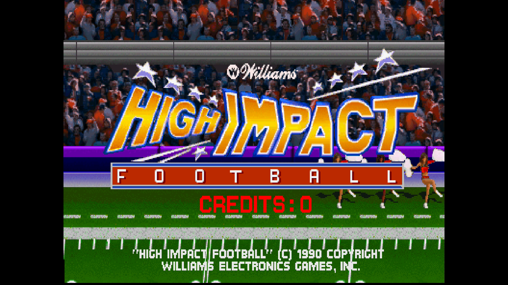 | 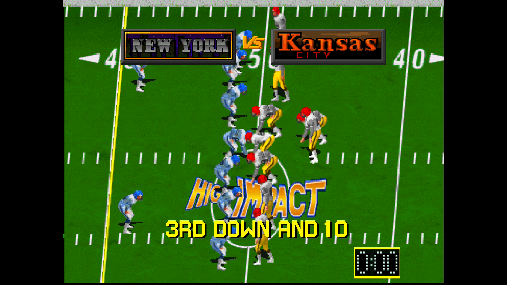 |
| [Mortal Kombat](docs/MortalKombat.md) | mkla4 (rev 4.0) |  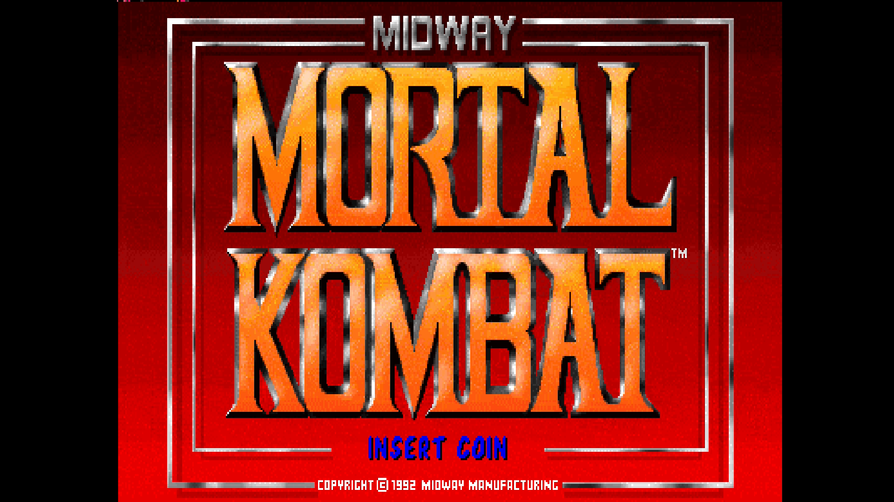 | 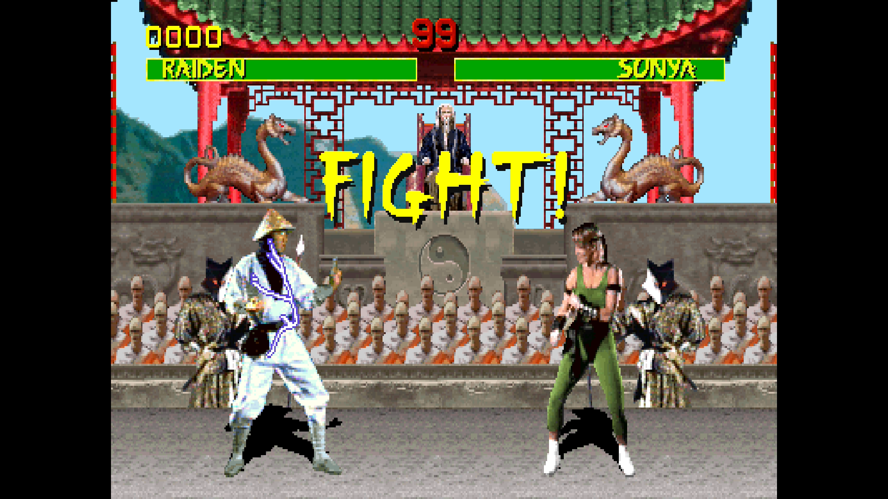 |
| [Smash T.V.](docs/SmashTV.md) | smashtv (rev 8.00) | 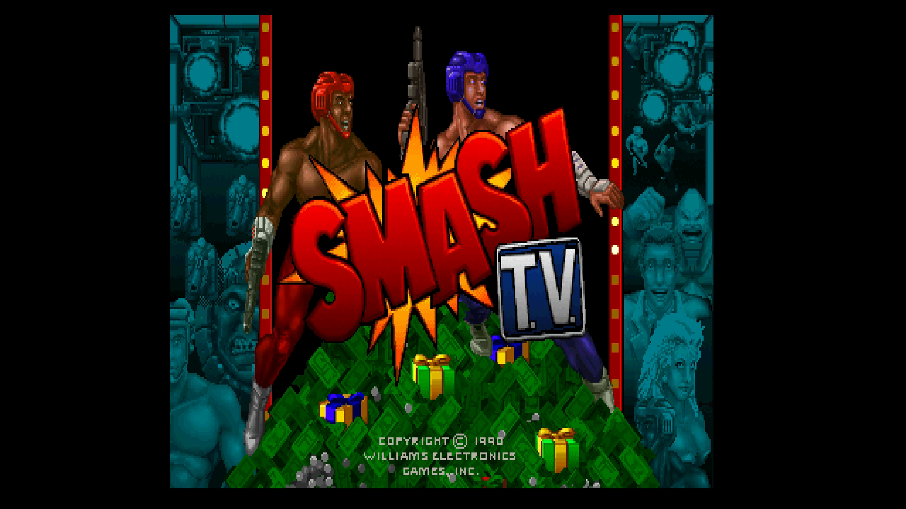 | 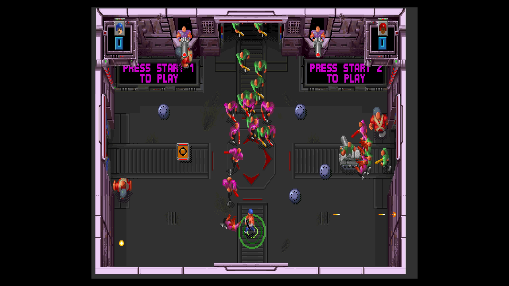 |
| [Strike Force](docs/StrikeForce.md) | strkforc (rev 1) | 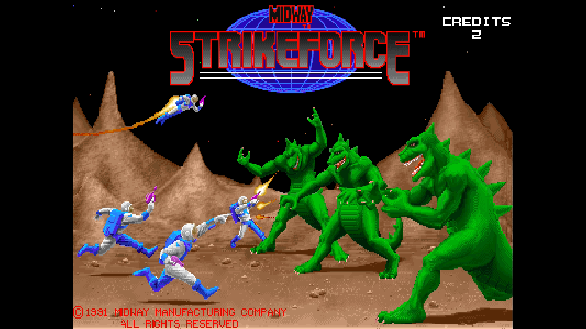 | 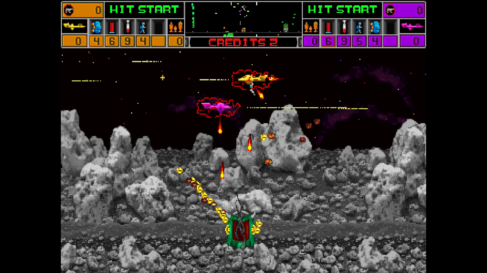 |
| [Super High Impact](docs/SuperHighImpact.md) | shimpact (rev LA2) | 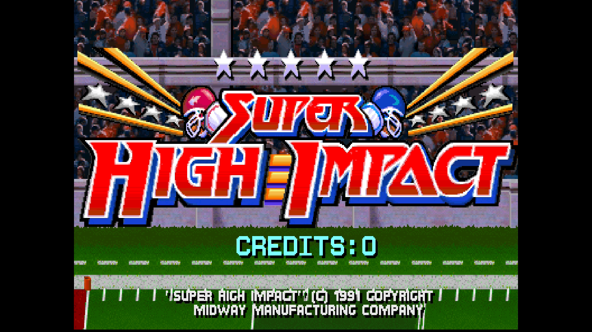 | 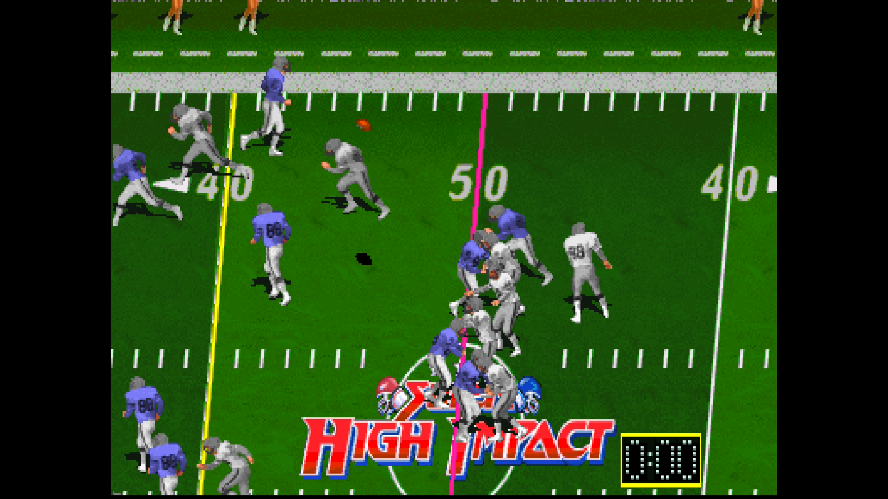 |
| [Terminator 2 - Judgment Day](docs/Terminator2.md) | term2 (rev LA4) | 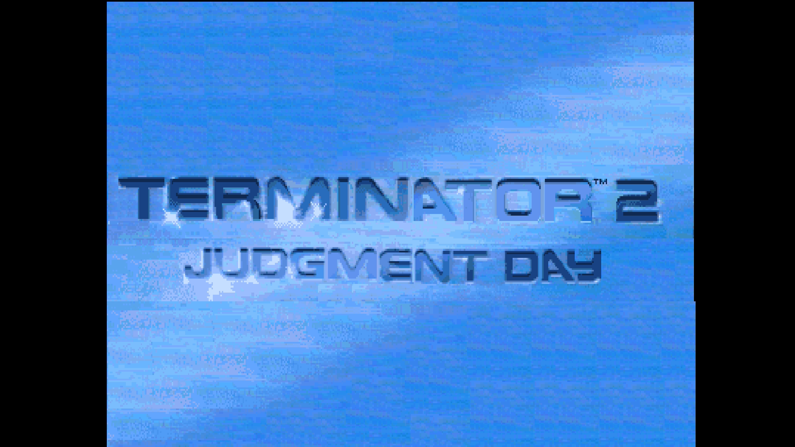 | 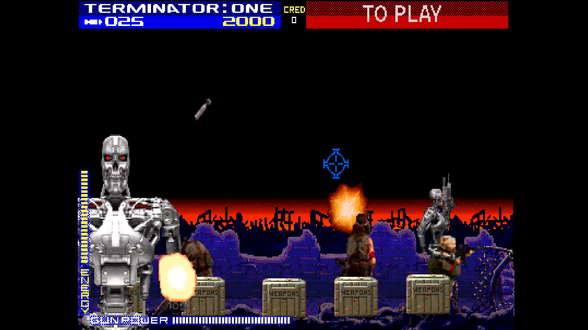 |
| [Total Carnage](docs/TotalCarnage.md) | totcarn (rev LA1) | 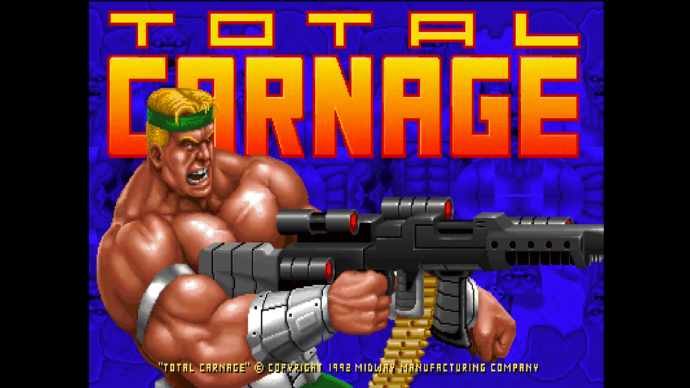 | 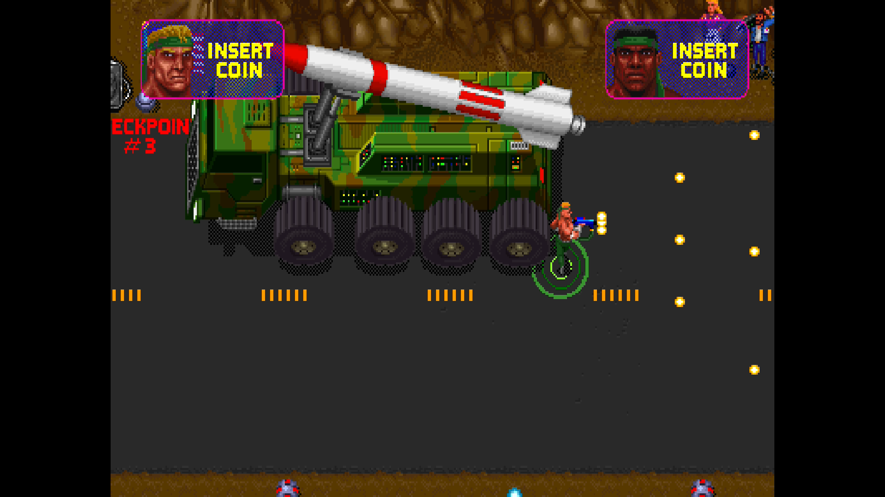 |
| [Trog](docs/Trog.md) | trog (rev LA5), prototype rev 4.00 | 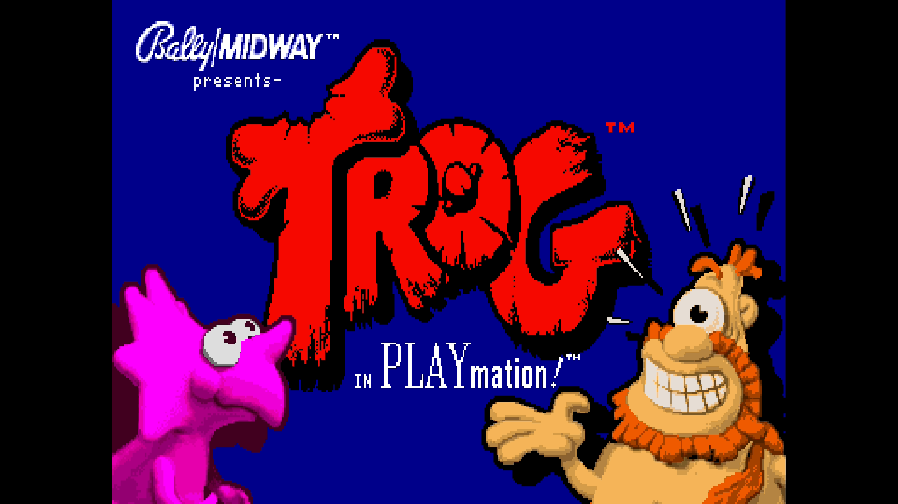 | 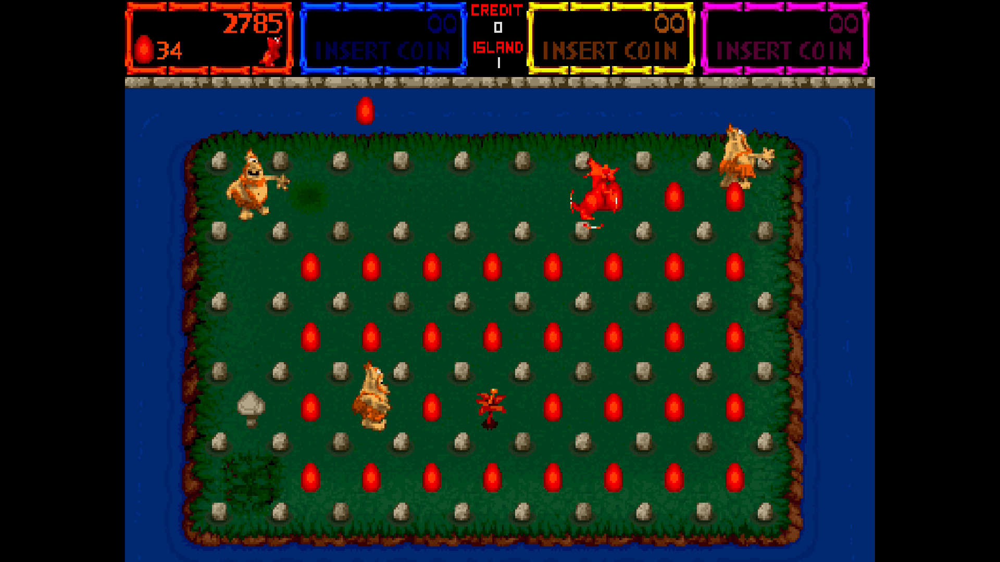 |

## Timing and resources

Built with Quartus Prime 17.0.2 Lite for the DE10-Nano (Cyclone V
5CSEBA6U23I7), timing model Slow 1100 mV 100 C. Timing and resource use are
from the Build 110 compilation.

Timing is met on every clock, and on every hold, recovery, removal and minimum
pulse width check. The margins move a little with every compilation.

| Clock | Frequency | Setup slack |
|---|---|---|
| System (core PLL) | 96 MHz | 0.378 ns |
| HDMI PLL | 148.54 MHz | 0.206 ns |

Every other clock has at least 3.9 ns of setup slack.

| Resource | Used |
|---|---|
| Logic (ALMs) | 30,684 / 41,910 (73 %) |
| Block RAM (M10K blocks) | 437 / 553 (79 %) |
| DSP blocks | 65 / 112 (58 %) |

## ROMs

ROMs are **not** included in this repository; you need your own dumps of the
games.  Use **merged** ROM sets. Files are found by CRC.  Put the zips in `games/mame`, the MRA files in
 `_Arcade` and the core in `_Arcade/cores`.

## Credits and references

- MAME Y Unit driver: Alex Pasadyn, Zsolt Vasvari, Ernesto Corvi, Aaron Giles
  (thanks to Kurt Mahan); MAME TMS34010 core, Williams sound boards, 6821 PIA
  and HC-55516 model (Jonathan Gevaryahu) - the reference for this core's
  behaviour
- Texas Instruments TMS34010 User's Guide
- mc6809 core: Greg Miller (synchronous version by Sorgelig)
- jt51 (YM2151) and jt6295 (OKI M6295): Jose Tejada (jotego)
- tv80 (Z80): Guy Hutchison, based on the T80 core by Daniel Wallner
- SDRAM controller and MiSTer framework: Sorgelig and the MiSTer-devel team
- CRT Adjust and CRT V-Size: Umberto Parisi (rmonic79), with Andrea Bogazzi
  (@asturur)
- [Template_MiSTer](https://github.com/MiSTer-devel/Template_MiSTer),
  [MiSTer-CRT-Adjust](https://github.com/rmonic79/MiSTer-CRT-Adjust)
- ppriest: [MiSTer-CoreSkill](https://github.com/ppriest/MiSTer-CoreSkill),
  the arcade core guidance used while developing and checking this core

### Cheat credits

The cheats for these games come from the MAME cheat collection (the cheat.txt
of the 27 July 2025 release, for MAME 0.279;
[mamecheat.co.uk](https://www.mamecheat.co.uk)), kept by Martin Pugh (Pugsy)
with the cheat finders named in its contributor list. The Cheats menu offers
them; the Mortal Kombat cheats are the T-Unit game's, placed in each Y-Unit
ROM by matching the code. cheat.txt names the author of a game's ROM cheats;
RAM cheats are credited to the contributor list as a whole. Per game, as
cheat.txt gives it:

| Game | Credit in cheat.txt |
|---|---|
| Mortal Kombat | Steph (Steph Humbert, Ultimate Patchers) and ugetab: the original cheats. Abystus: ROM cheats (various). Martin Pugh (Pugsy): Clues, Secret Game Over, CPU Fatality and EJB Menu. nolberto82: Hit Anywhere and One Button Fatalities |
| Smash T.V. | Pugsy and ugetab |
| Total Carnage | Pugsy |
| Trog | Pugsy |
| High Impact Football, Super High Impact, Strike Force, Terminator 2 | no author is named for these games: the contributor list |

## License

GPL-3.0-or-later. Third-party modules keep their own licenses (see `rtl/mc6809`,
`rtl/jt51`, `rtl/jt6295`, `rtl/tv80`, `rtl/crt_adjust`).
