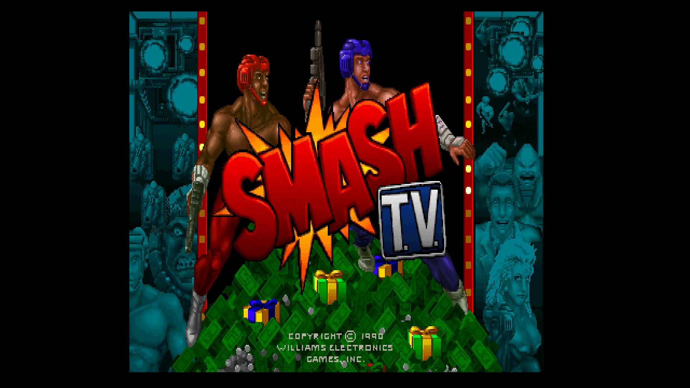
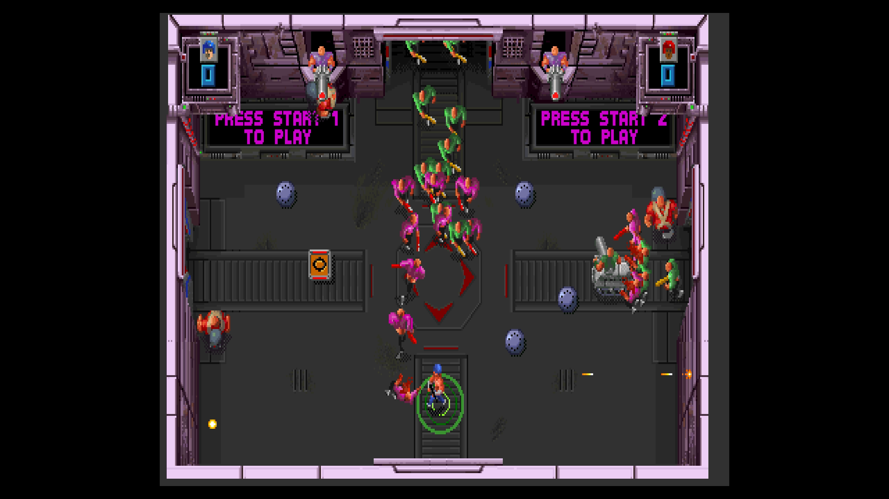

# Smash T.V.

[Back to the main README](../README.md)

 

| | |
|---|---|
| Sets | smashtv (rev 8.00, main MRA); rev 6.00, 5.00, 4.00, 3.01 |
| ROM zip | `smashtv.zip` (merged set) |
| Players | 2 |
| Sound | CVSD board |

## Extra content

Smash T.V. has one game-specific OSD item, the Cheats menu.

- **[Cheats](#cheats)** (Cheats menu): 4 cheats: infinite ammo, invincibility after dying, and infinite lives for each player.
- **Fire from buttons or the right stick**: B1-B4 fire up, down, left and right (two together fire diagonally), or the right analog stick fires in the direction it points.
- **Opposite directions**: Up with Down and Left with Right never reach the game, on the move stick or the fire stick; the one pressed last wins.
- **Coin 3** on the third controller's Coin button.

The [core-wide extras](ExtraContent.md#core-wide-features) (CRT Adjust, CRT V-Size, Video Timing, DIP Switches, Service Mode and the rest) apply to every game.

## Cheats

The Cheats item in the OSD lists the cheats of the game; switch on as many as you like. A cheat of kind On works for as long as it is on; a cheat of kind Once acts one time, when you switch it on, and switching it off and on again repeats it. The cheats come from the MAME cheat collection ([credits](../README.md#cheat-credits)). They are off while a test menu is selected (Service Mode, the Test button or the Test Switch DIP) and come back when it is left. The core takes up to 16 cheat units and 4 one-shot writes at once (a cheat is one to 6 units), so with many cheats on at the same time the last ones are ignored.

| Menu name | MAME cheat | Kind | Not in |
|---|---|---|---|
| Infinite Ammo | same | On | - |
| Invincible After Dying | Invincibility (Die to Activate) | On | - |
| P1 Infinite Lives | same | On | - |
| P2 Infinite Lives | same | On | - |

Select Permanent Weapon, in the MAME file, is not offered: it picks one of five weapons and needs a long list of writes.

## High scores

Smash T.V. keeps two tables, ALL TIME and TODAY. As on the board, TODAY starts afresh every time the game starts: loading the MRA, a Reset or a power-up. Only the ALL TIME table is kept, so a score has to make that table to be there next time. The NVRAM is saved when the OSD opens, so open the OSD after the table has shown your initials.

## Controls

Smash T.V. is a twin-stick game: one stick moves, the other fires.

| Input | Use |
|---|---|
| Stick (d-pad / left stick) | Move (Up with Down or Left with Right: the last press wins) |
| B1-B4 | Fire up, down, left, right (pressing two fires diagonally; opposite ones: the last press wins) |
| Right analog stick | Fire in the direction it points, instead of B1-B4 |
| Start / Coin | Players 1-2; the third controller's Coin is coin 3 |
| Test, Pause | Service mode switch, pause |
