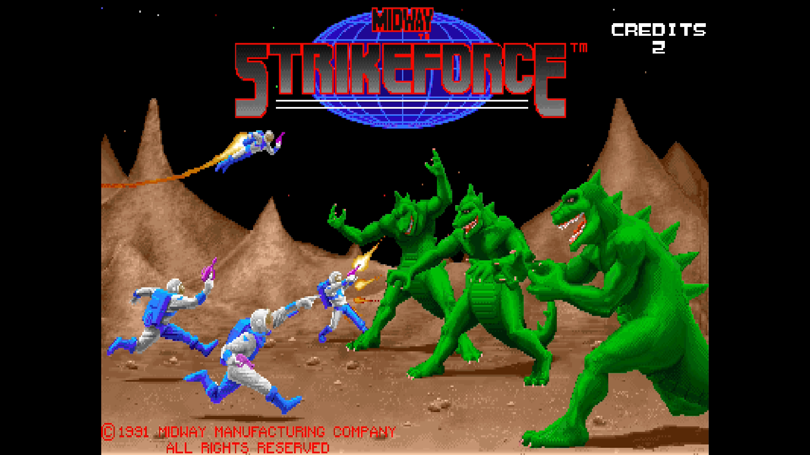
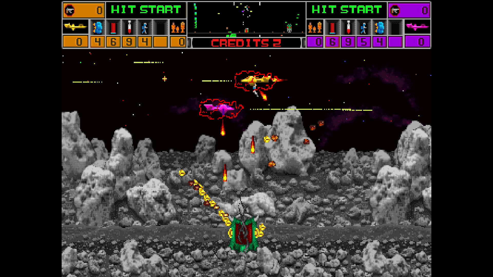

# Strike Force

[Back to the main README](../README.md)

 

| | |
|---|---|
| Sets | strkforc (rev 1, main MRA); Saurian Front (proto v5.0) |
| ROM zip | `strkforc.zip` (merged set) |
| Players | 2 |
| Sound | CVSD board |

## Extra content

Strike Force has one game-specific OSD item, the Cheats menu.

- **[Cheats](#cheats)** (Cheats menu): 4 cheats: infinite lives and infinite weapons for each player (not in Saurian Front).
- **Short DIP labels**: Coin A's two-step settings are written short ("1C/1C - 2C/3C") and "Points for Extra Ship" is "Extra Ship Points", so the value fits on the DIP menu line.
- **Coins 3 and 4** on the third and fourth controllers' Coin buttons.
- **Saurian Front** (the prototype v5.0) has its own MRA among the alternatives.

The [core-wide extras](ExtraContent.md#core-wide-features) (CRT Adjust, CRT V-Size, Video Timing, DIP Switches, Service Mode and the rest) apply to every game.

## Cheats

The Cheats item in the OSD lists the cheats of the game; switch on as many as you like. A cheat of kind On works for as long as it is on; a cheat of kind Once acts one time, when you switch it on, and switching it off and on again repeats it. The cheats come from the MAME cheat collection ([credits](../README.md#cheat-credits)). They are off while a test menu is selected (Service Mode, the Test button or the Test Switch DIP) and come back when it is left. The core takes up to 16 cheat units and 4 one-shot writes at once (each cheat is one unit), so with many cheats on at the same time the last ones are ignored.

| Menu name | MAME cheat | Kind | Not in |
|---|---|---|---|
| P1 Infinite Lives | same | On | Proto v5.0 |
| P1 Infinite Weapons | P1 Infinite weapons | On | Proto v5.0 |
| P2 Infinite Lives | same | On | Proto v5.0 |
| P2 Infinite Weapons | P2 Infinite weapons | On | Proto v5.0 |

Saurian Front, the prototype, has no cheats: the game's variables are laid out differently from rev 1 and could not be found in its ROM with confidence.

## Controls

| Input | Use |
|---|---|
| Stick | Move (8-way) |
| B1 | Fire |
| B2 | Weapon |
| B3 | Weapon Select |
| Start | Start / Transform |
| Coin | Players 1-2; the third and fourth controllers' Coin are coins 3 and 4 |
| Test, Pause | Service mode switch, pause |

In the DIP Switches menu, Coin A's two-step settings are written short:
1C/1C - 2C/3C is 1 coin for 1 credit and 2 coins for 3 credits. Extra Ship
Points is the score for an extra ship.
