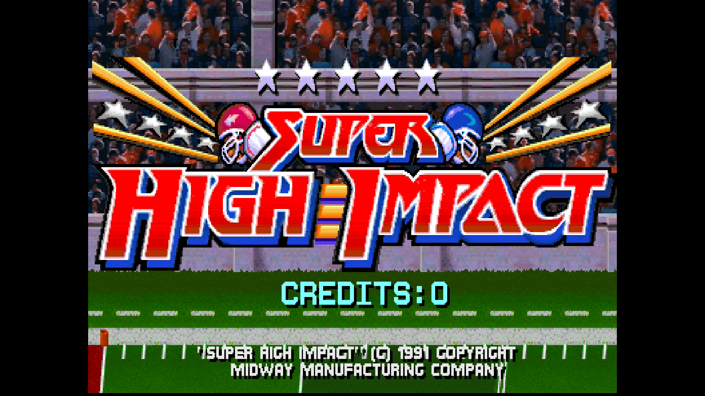
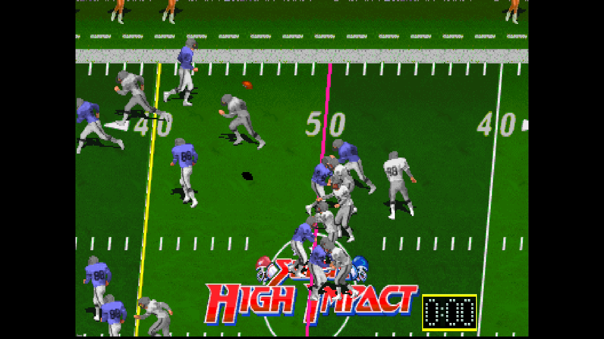

# Super High Impact

[Back to the main README](../README.md)

 |  

| | |
|---|---|
| Sets | shimpact (rev LA2, main MRA); LA1, prototypes 6.0, 5.0, 4.0 |
| ROM zip | `shimpact.zip` (merged set) |
| Players | 4 (or 2 with the Players DIP switch) |
| Sound | CVSD board |

## Extra content

- **[Cheats](#cheats)** (Cheats menu): 6 cheats: infinite time for each of the four players and for the quarter, and End Quarter Now.
- **[Octopus Bookkeeping shortcut](#hidden-developer-menu-octopus-bookkeeping)** (Hidden Items, revisions LA2 and LA1): the core plays the 27-press code for you, in about 3 seconds. The game accepts it only while attract mode shows HIGHEST PAID SUPERSTARS, so the core says "Not now" at any other time instead of spoiling the code. The prototypes have no menu and do not show the item.
- **Readable Coinage menu**: the USA settings, so all six can be reached from the OSD, written short.
- **Coins 3 and 4** on the third and fourth controllers' Coin buttons.

The [core-wide extras](ExtraContent.md#core-wide-features) (CRT Adjust, CRT V-Size, Video Timing, DIP Switches, Service Mode and the rest) apply to every game.

## Cheats

The Cheats item in the OSD lists the cheats of the game; switch on as many as you like. A cheat of kind On works for as long as it is on; a cheat of kind Once acts one time, when you switch it on, and switching it off and on again repeats it. The cheats come from the MAME cheat collection ([credits](../README.md#cheat-credits)). They are off while a test menu is selected (Service Mode, the Test button or the Test Switch DIP) and come back when it is left. The core takes up to 16 cheat units and 4 one-shot writes at once (a cheat is one to 2 units), so with many cheats on at the same time the last ones are ignored.

| Menu name | MAME cheat | Kind | Not in |
|---|---|---|---|
| End Quarter Now | End Quarter Now! | Once | - |
| Infinite Quarter Time | same | On | - |
| P1 Infinite Time | same | On | - |
| P2 Infinite Time | same | On | - |
| P3 Infinite Time | same | On | - |
| P4 Infinite Time | same | On | - |

## Controls

| Input | Use |
|---|---|
| Stick | Move (8-way) |
| B1 | Action |
| Start / Coin | Players 1-4; the third and fourth controllers' Coin are coins 3 and 4 |
| Test, Pause | Service mode switch, pause |

The **Players** DIP switch (OSD, DIP Switches) sets a 4-player or 2-player
cabinet. **Coinage** lists the USA settings: 1 Coin/1 Credit, 2 Coins/1
Credit, 2C/1C - 4C/3C (2 coins for 1 credit, 4 coins for 3), 2C/1C - 4C/4C,
ECA and Free Play. With **Country** at German or French the same positions
give that country's coin values, as on the operator's DIP switch chart.

## Hidden developer menu: Octopus Bookkeeping

Revisions LA2 and LA1 hide a page of developer audits behind a 27-press code.
**OSD → Hidden Items → Octopus Bookkeeping** enters it for you (about 3 seconds;
leave the controls alone). The game only accepts it while attract mode shows
**HIGHEST PAID SUPERSTARS** (about 8 seconds, roughly half a minute into each
attract cycle), so select it while that screen is up; with "Pause when OSD is
open" it starts when the OSD closes. The prototypes have no such menu.

A message says how it went: "Octopus Bookkeeping: code entered" when the
page opens, "Not now: the code works while the attract mode shows HIGHEST
PAID SUPERSTARS" at any other time (the code is not entered), "Code not
taken: try again" if the page did not open (the screen changed while the
code played). The prototypes do not show the item (Hidden Items is empty
there).

By hand: press the Action buttons of P2 (0) and P3 (1) in the order
`0 0 0 0 0 1 1 1 1 1 1 1 1 1 1 0 0 1 0 0 1 1 1 0 0 0 0`, each press within
about a quarter of a second of the last; with the Players DIP switch at 2,
use P1 (0) and P2 (1).
