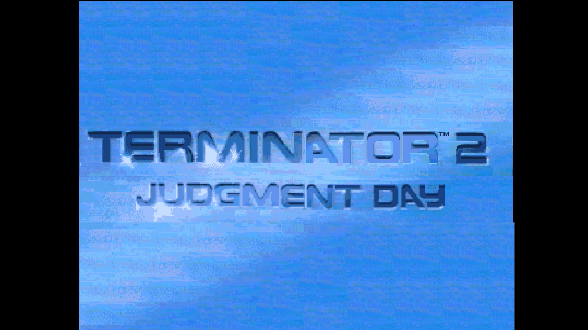
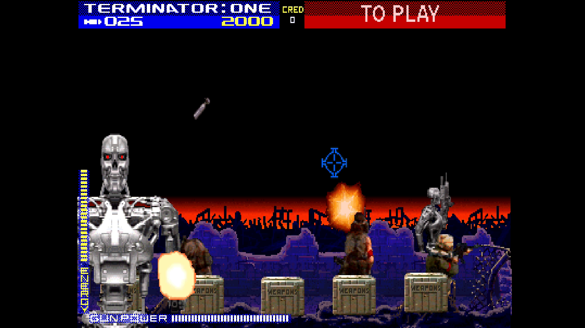

# Terminator 2 - Judgment Day

[Back to the main README](../README.md)

 

| | |
|---|---|
| Sets | term2 (rev LA4, main MRA); LA3, LA2, LA1, prototype PA2, German LG1 |
| ROM zip | `term2.zip` (merged set) |
| Players | 2 |
| Sound | ADPCM board |

## Extra content

Terminator 2 gets its gun control as an [OSD entry](#osd) in the DIP Switches menu.

- **[Cheats](#cheats)** (Cheats menu): 13 cheats: for each player infinite energy, gun power, missiles, 3-way missiles, the plasma pulse energizer and no human casualties, and Equipment Intact to 0 Now.
- **Gun Control**: Joystick or Mouse for player 1.
- **Aiming**: each player's gun is aimed with the left analog stick (it points directly) or the d-pad (it moves the aim); player 1 can also use the mouse. The crosshairs on screen are the game's own.
- **Coins 3 and 4** on the third and fourth controllers' Coin buttons.

The [core-wide extras](ExtraContent.md#core-wide-features) (CRT Adjust, CRT V-Size, Video Timing, DIP Switches, Service Mode and the rest) apply to every game.

## Cheats

The Cheats item in the OSD lists the cheats of the game; switch on as many as you like. A cheat of kind On works for as long as it is on; a cheat of kind Once acts one time, when you switch it on, and switching it off and on again repeats it. The cheats come from the MAME cheat collection ([credits](../README.md#cheat-credits)). They are off while a test menu is selected (Service Mode, the Test button or the Test Switch DIP) and come back when it is left. The core takes up to 16 cheat units and 4 one-shot writes at once (each cheat is one unit), so with many cheats on at the same time the last ones are ignored.

| Menu name | MAME cheat | Kind | Not in |
|---|---|---|---|
| Equipment Intact to 0 Now | Set Equipment Intact to 0 Now! | Once | - |
| P1 Infinite 3-Way Missile | P1 Infinite 3-Way Missiles | On | - |
| P1 Infinite Energy | same | On | - |
| P1 Infinite Gun Power | same | On | - |
| P1 Infinite Missiles | same | On | - |
| P1 No Human Casualties | P1 No Human Casualties L1 + L2 | On | - |
| P1 Plasma Pulse Energizer | P1 Always have Plasma Pulse Energizer | On | - |
| P2 Infinite 3-Way Missile | P2 Infinite 3-Way Missiles | On | - |
| P2 Infinite Energy | same | On | - |
| P2 Infinite Gun Power | same | On | - |
| P2 Infinite Missiles | same | On | - |
| P2 No Human Casualties | P2 No Human Casualties L1 + L2 | On | - |
| P2 Plasma Pulse Energizer | P2 Always have Plasma Pulse Energizer | On | - |

## Controls

Terminator 2 is a gun game; each player's gun is aimed with the left analog
stick (it points directly), the d-pad (moves the aim) or, for player 1,
the mouse. The crosshairs are the game's own.

| Input | Use |
|---|---|
| Left analog stick / d-pad | Aim |
| B1 | Trigger |
| B2 | Bomb |
| Start / Coin | Players 1-2; the third and fourth controllers' Coin are coins 3 and 4 |
| Test, Pause | Service mode switch, pause |

## OSD

One entry in the DIP Switches menu (with the game's switches):

| Entry | |
|---|---|
| Gun Control | Joystick or Mouse (player 1) |
