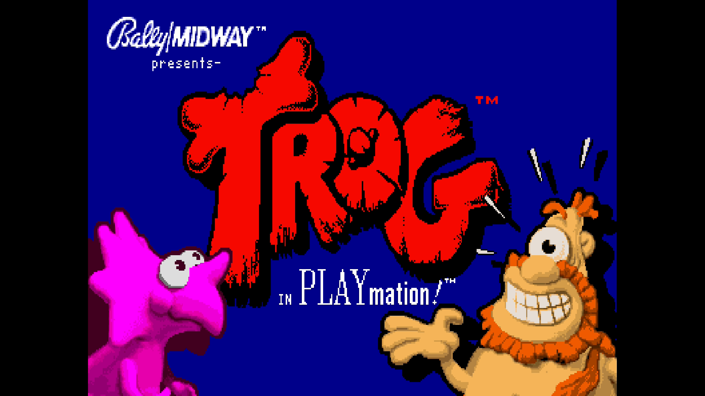
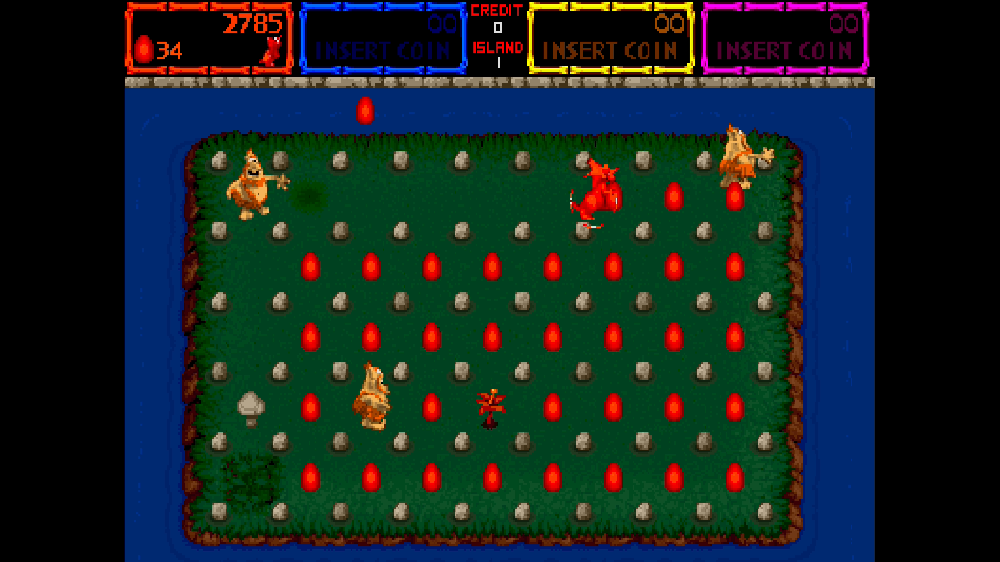

# Trog

[Back to the main README](../README.md)

  

| | |
|---|---|
| Sets | trog (rev LA5, main MRA); LA4, LA3 (2-14-91), LA3 (2-10-91), prototypes PA6-PAC and PA5-PAC; the Maze bootleg of rev LA4 (mazebl); prototype rev 4.00 (trogpa4, its own MRA) |
| ROM zip | `trog.zip` (merged set) |
| Players | 4 |
| Sound | CVSD board |

## Extra content

Trog has one game-specific OSD item, the Cheats menu.

- **[Cheats](#cheats)** (Cheats menu): 5 cheats: invincibility and infinite lives for each of the four players.
- **4-way stick filter**: on a diagonal the direction pressed last wins, like the cabinet's 4-way joysticks.
- **Prototype rev 4.00** (trogpa4) has its own MRA among the alternatives, with an 8-way stick and a Bone button in place of Punch.
- **Four players**, with coin 3 on the third controller's Coin button.

The [core-wide extras](ExtraContent.md#core-wide-features) (CRT Adjust, CRT V-Size, Video Timing, DIP Switches, Service Mode and the rest) apply to every game.

## Cheats

The Cheats item in the OSD lists the cheats of the game; switch on as many as you like. A cheat of kind On works for as long as it is on; a cheat of kind Once acts one time, when you switch it on, and switching it off and on again repeats it. The cheats come from the MAME cheat collection ([credits](../README.md#cheat-credits)). They are off while a test menu is selected (Service Mode, the Test button or the Test Switch DIP) and come back when it is left. The core takes up to 16 cheat units and 4 one-shot writes at once (a cheat is one to 6 units), so with many cheats on at the same time the last ones are ignored.

| Menu name | MAME cheat | Kind | Not in |
|---|---|---|---|
| Invincibility | same | On | - |
| P1 Infinite Lives | same | On | - |
| P2 Infinite Lives | same | On | - |
| P3 Infinite Lives | same | On | - |
| P4 Infinite Lives | same | On | - |

## High scores

Trog keeps two tables, TOP TROGS and DAILY DINOS. As on the board, DAILY DINOS starts afresh every time the game starts: loading the MRA, a Reset or a power-up. Only TOP TROGS is kept, so a score has to make that table to be there next time. Trog writes the new table to its NVRAM about 8 seconds after the initials (after the continue countdown, as the game goes back to the attract mode). The NVRAM is saved when the OSD opens, so wait until the table shows your initials before opening the OSD.

## Controls

| Input | Use |
|---|---|
| Stick | 4-way: on a diagonal, the direction pressed last wins, like the cabinet's 4-way joysticks |
| B1 | Punch (prototype rev 4.00: Bone; its stick is 8-way) |
| Start / Coin | Players 1-4; the third controller's Coin is coin 3 |
| Test, Pause | Service mode switch, pause |
